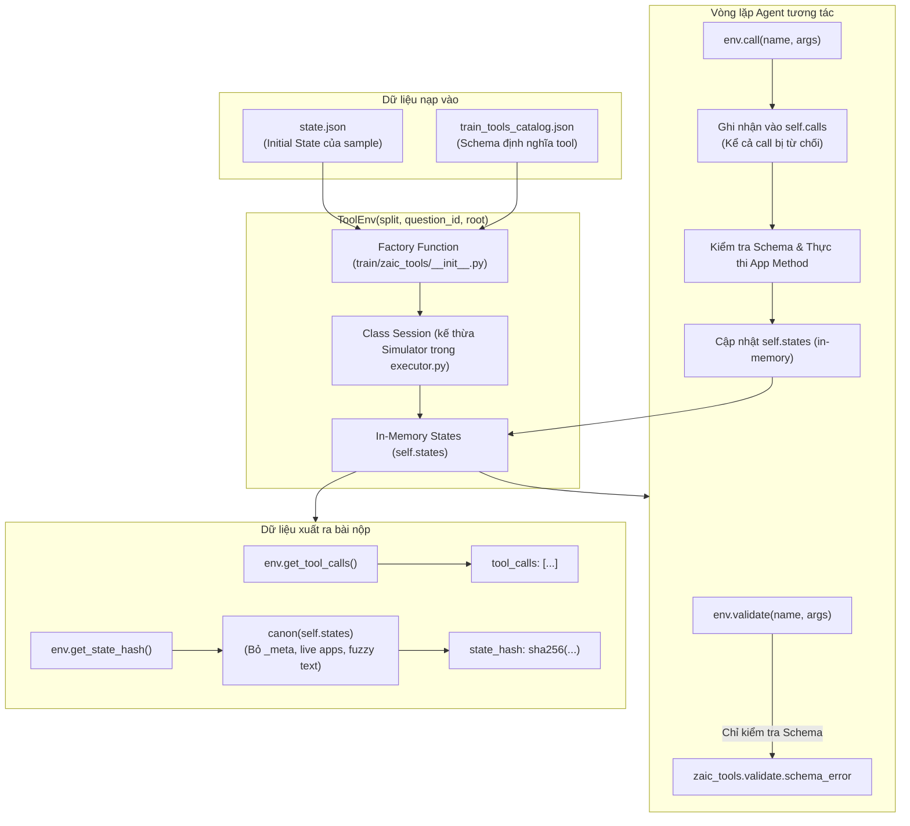
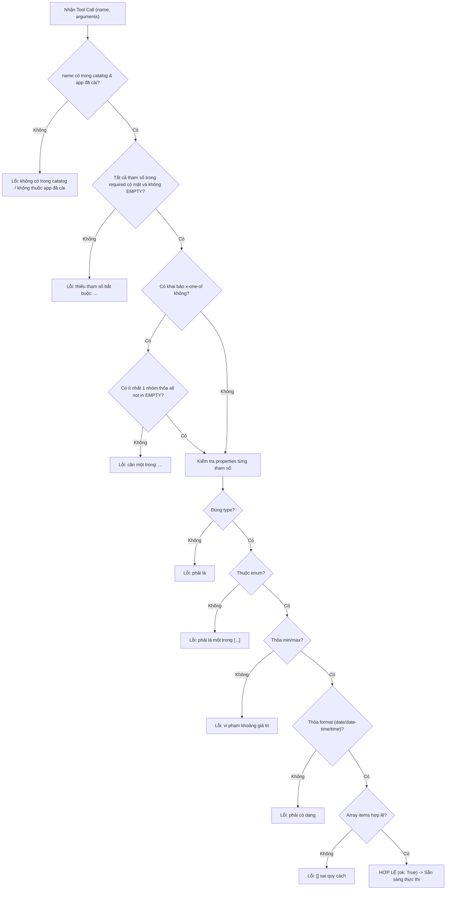

# ZAIC_TOOLS INTERNALS & CATALOG SPECIFICATION

> **Tài liệu tham chiếu kỹ thuật chi tiết:** Phân tích mã nguồn thư viện môi trường giả lập `zaic_tools/`, tập schema `train_tools_catalog.json`, và quy chế chấm thi chính thức của Zalo AI Challenge 2026 (Track LifeMate).

---

## MỤC LỤC
1. [Tổng quan kiến trúc `zaic_tools`](#1-tổng-quan-kiến-trúc-zaic_tools)
2. [Chi tiết hoạt động các hàm public của `ToolEnv`](#2-chi-tiết-hoạt-động-các-hàm-public-của-toolenv)
   - [2.1. Hàm `validate(name, arguments)`](#21-hàm-validatename-arguments)
   - [2.2. Hàm `call(name, arguments)`](#22-hàm-callname-arguments)
   - [2.3. Hàm `get_tool_calls()`](#23-hàm-get_tool_calls)
   - [2.4. Hàm `get_state_hash()`](#24-hàm-get_state_hash)
   - [2.5. Hàm bổ trợ `get_state()`](#25-hàm-bổ-trợ-get_state)
3. [Cơ chế phân biệt tham số Fuzzy vs. Non-Fuzzy & Token-F1](#3-cơ-chế-phân-biệt-tham-số-fuzzy-vs-non-fuzzy--token-f1)
   - [3.1. Điểm khác biệt cốt lõi](#31-điểm-khác-biệt-cốt-lõi)
   - [3.2. Tiêu chí đánh giá Token-F1 > 0.6](#32-tiêu-chí-đánh-giá-token-f1--06)
   - [3.3. Tác động của tham số Fuzzy lên `state_hash`](#33-tác-động-của-tham-số-fuzzy-lên-state_hash)
   - [3.4. Vị trí & Danh sách toàn bộ 40 tham số Fuzzy trong Catalog](#34-vị-trí--danh-sách-toàn-bộ-40-tham-số-fuzzy-trong-catalog)
4. [Các ràng buộc đặc biệt trong `train_tools_catalog.json`](#4-các-ràng-buộc-đặc-biệt-trong-train_tools_catalogjson)
   - [4.1. Ràng buộc `required`](#41-ràng-buộc-required)
   - [4.2. Ràng buộc `x-one-of`](#42-ràng-buộc-x-one-of)
   - [4.3. Ràng buộc `x-ref`](#43-ràng-buộc-x-ref)
   - [4.4. Ràng buộc `enum`](#44-ràng-buộc-enum)
   - [4.5. Định dạng thời gian `format` (date, date-time, time)](#45-định-dạng-thời-gian-format-date-date-time-time)
   - [4.6. Ràng buộc khoảng giá trị (numeric ranges)](#46-ràng-buộc-khoảng-giá-trị-numeric-ranges)
   - [4.7. Ràng buộc phạm vi ứng dụng đã cài đặt (`installed_apps`)](#47-ràng-buộc-phạm-vi-ứng-dụng-đã-cài-đặt-installed_apps)
5. [Tóm tắt nguyên tắc vàng khi xây dựng Agent](#5-tóm-tắt-nguyên-tắc-vàng-khi-xây-dựng-agent)

---

## 1. Tổng quan kiến trúc `zaic_tools`

`zaic_tools` là gói thư viện runtime chuẩn của Ban tổ chức Zalo AI Challenge 2026 dùng để mô phỏng môi trường ứng dụng và chấm điểm bài thi LifeMate bằng cơ chế **Replay**.



### Cấu trúc mô-đun mã nguồn:
* `zaic_tools/__init__.py`: Cung cấp hàm khởi tạo `ToolEnv(...)`, `catalog_path(...)`, export participant API.
* `zaic_tools/executor.py`: Chứa class `Simulator` (engine chạy tool cơ sở) và `Session` (phiên làm việc độc lập của từng sample).
* `zaic_tools/validate.py`: Hệ thống xác thực schema duy nhất (`schema_error`, `schema_validate`), là bộ luật từ chối call dùng chung cho runtime, executor, CLI và ban giám khảo (scorer).
* `zaic_tools/utils.py`: Chuẩn hóa văn bản (`_fold`, `_norm`, `_tokens`), danh sách `LIVE_APPS`, `FREE_TEXT_KEYS`, thuật toán sinh `canon(state)` và hàm băm `state_hash(state)`.
* `zaic_tools/apps/base.py`: Lớp cơ sở `App` định nghĩa các hàm thao tác chung trên state (`read`, `create`, `patch`, `delete`, `contact_ref`, `noop`).
* `zaic_tools/apps/<app>.py`: 46 module ứng dụng tương ứng với các app trong catalog, mỗi tool là một method mang decorator `@read`, `@write`, hoặc `@meta`.

---

## 2. Chi tiết hoạt động các hàm public của `ToolEnv`

Khi gọi `env = ToolEnv(split, question_id, root=".")`, thực chất đây là một **factory function** khởi tạo một phiên làm việc độc lập `Session(question_id, state_dict, catalog)`.

```python
# train/zaic_tools/__init__.py:32-41
def ToolEnv(split: str, question_id: str, root: str | Path | None = None) -> Session:
    root = Path(root) if root else DATA_ROOT
    state_path = root / split / f"{split}_environment" / question_id / "state.json"
    if not state_path.is_file():
        raise FileNotFoundError(f"no state for {question_id!r}: {state_path}")
    cp = catalog_path(split, root)
    catalog = json.load(open(cp, encoding="utf-8")) if cp.is_file() else None
    return Session(question_id, json.load(open(state_path, encoding="utf-8")), catalog)
```

Mỗi `Session` sở hữu một bản sao in-memory độc lập của `state.json` (`self.states`), tập các công cụ được phép gọi `self.allowed`, và danh sách lịch sử gọi `self.calls`.

---

### 2.1. Hàm `validate(name, arguments)`

```python
# train/zaic_tools/executor.py:64-67
def validate(self, name: str, arguments: dict | None = None) -> dict:
    """Schema check only, nothing executed: {"ok": True, "error": None} or {"ok": False, "error": "..."}."""
    err = schema_error(name, arguments or {}, self.tools, self.allowed)
    return {"ok": err is None, "error": err}
```

* **Mục đích:** Kiểm tra tính hợp lệ về mặt Schema của một tool call dự kiến trước khi thực thi.
* **Cơ chế hoạt động:**
  1. Chỉ gọi duy nhất hàm `schema_error(name, arguments or {}, self.tools, self.allowed)` trong `zaic_tools/validate.py`.
  2. Đối chiếu `name` với danh sách tool trong catalog và `self.allowed` (tập tool thuộc các app đã cài + `sys.ask_missing_info`).
  3. Kiểm tra các tham số `required`, `x-one-of`, kiểu dữ liệu (`type`), `enum`, `minimum`, `maximum`, `format`, và `items`.
  4. Trả về `{"ok": True, "error": None}` nếu hợp lệ, hoặc `{"ok": False, "error": "chi tiết lỗi"}` nếu sai.
* **Điểm cốt lõi:**
  - **HOÀN TOÀN KHÔNG thực thi tool**.
  - **KHÔNG thay đổi state**.
  - **KHÔNG ghi nhận vào lịch sử cuộc gọi `self.calls`**.
  - Dùng an toàn cho Agent tự kiểm tra / reflection trước khi thực thi thực sự.

---

### 2.2. Hàm `call(name, arguments)`

Hàm `call` trong `Session` ghi nhận cuộc gọi vào lịch sử trước, sau đó chuyển giao cho `Simulator.call`:

```python
# train/zaic_tools/executor.py:95-98 (Session)
def call(self, name: str, arguments: dict | None = None) -> dict:
    arguments = arguments or {}
    self.calls.append({"name": name, "arguments": copy.deepcopy(arguments)})
    return super().call(name, arguments)
```

Chi tiết luồng xử lý bên trong `Simulator.call` (`executor.py:48-62`):

```python
# train/zaic_tools/executor.py:48-62 (Simulator)
def call(self, name: str, arguments: dict | None) -> dict:
    arguments = arguments or {}
    err = schema_error(name, arguments, self.tools, self.allowed)
    if err is None and name not in TOOLS:
        err = f"tool '{name}' chưa được simulator hỗ trợ"
    if err is not None:
        return self._fail(name, arguments, err)
    app, tool = name.split(".", 1)
    try:
        result = getattr(self.apps[app], tool)(**{k: v for k, v in arguments.items() if isinstance(k, str) and k.isidentifier()})
    except Exception as e:
        result = {"ok": True, "done": False, "message": f"{type(e).__name__}: {e}"}
    result = copy.deepcopy(result)
    self.log.append({"name": name, "arguments": arguments, "result": result})
    return result
```

* **Quy trình 5 bước chặt chẽ:**
  1. **Lưu lịch sử nộp bài ngay lập tức:** `self.calls.append({"name": name, "arguments": copy.deepcopy(arguments)})`.
     > [!WARNING]
     > Một khi đã gọi `env.call()`, dù call đó có bị lỗi schema hay thất bại thì nó **vẫn được lưu vào `self.calls`** và sẽ tính vào số lượng cuộc gọi không khớp ($U$) khi chấm điểm nếu không có trong gold calls!
  2. **Kiểm tra Schema (`schema_error`):**
     - Nếu vi phạm (sai app, thiếu required, sai type/enum/format...), gọi `self._fail(...)`:
       - Trả về `{"ok": False, "error": "<thông báo lỗi tiếng Việt>"}`.
       - Ghi vào nhật ký nội bộ `self.log`.
       - **State hoàn toàn không thay đổi**.
  3. **Điều hướng thực thi (Method Dispatch):**
     - Tách `app, tool = name.split(".", 1)`.
     - Lọc tham số kwargs chỉ lấy các khóa là chuỗi định danh hợp lệ (`isinstance(k, str) and k.isidentifier()`).
     - Gọi hàm tương ứng: `getattr(self.apps[app], tool)(**kwargs)`.
  4. **Bảo vệ ngoại lệ (Exception Guard):**
     - Khối `try...except Exception as e` bao phủ việc gọi hàm app.
     - **Không bao giờ raise Exception ra agent loop**.
     - Nếu có lỗi nội bộ phát sinh ngoài ý muốn, trả về: `{"ok": True, "done": False, "message": f"{type(e).__name__}: {e}"}`.
     - Lưu ý: Đây được tính là call chạy thành công nhưng không có kết quả (`ok: True`), không phải lỗi schema.
  5. **Chống Alias Dữ liệu (Isolation via Deepcopy):**
     - Kết quả trả về được sao chép sâu qua `copy.deepcopy(result)` trước khi trả cho caller và lưu vào `self.log`.
     - Ngăn ngừa Agent chỉnh sửa dict kết quả làm biến dạng trạng thái in-memory của app.

* **Quy tắc nghiệp vụ quan trọng:**
  - ID không tồn tại, số dư tài khoản không đủ, không tìm thấy kết quả tìm kiếm... **KHÔNG PHẢI LỖI SCHEMA**.
  - Tool vẫn chạy, state không đổi, và trả về dạng:
    `{"ok": True, "done": False, "message": "không tìm thấy id=..."}` hoặc `{"ok": True, "<collection>": []}`.

---

### 2.3. Hàm `get_tool_calls()`

```python
# train/zaic_tools/executor.py:100-102
def get_tool_calls(self) -> list[dict]:
    """Every call made in this session, in order, rejected calls included: the tool_calls field of the submission line."""
    return copy.deepcopy(self.calls)
```

* **Mục đích:** Xuất toàn bộ danh sách các cuộc gọi mà Agent đã thực hiện trong phiên theo đúng thứ tự thời gian.
* **Đặc tính kỹ thuật:**
  - Trả về danh sách `[{"name": "...", "arguments": {...}}, ...]`.
  - Bao gồm **tất cả các call**, kể cả call thành công, call rỗng, và call bị từ chối do sai schema (`ok: False`).
  - Dữ liệu này được gán trực tiếp vào trường `"tool_calls"` của dòng nộp bài trong `submission.jsonl`.

---

### 2.4. Hàm `get_state_hash()`

```python
# train/zaic_tools/executor.py:109-111
def get_state_hash(self) -> str:
    """sha256 of the canonical current state (zaic_tools.state_hash): the state_hash field of the submission line."""
    return state_hash(self.states)
```

* **Mục đích:** Tính toán mã băm SHA-256 đại diện cho trạng thái cuối cùng của môi trường.
* **Cơ chế hoạt động:**
  Hàm gọi `state_hash(self.states)` trong `zaic_tools/utils.py`:
  ```python
  # train/zaic_tools/utils.py:65-67
  def state_hash(state: dict) -> str:
      """sha256 of canon(state) serialised as sorted, compact, ASCII JSON — the value submitted as state_hash."""
      return hashlib.sha256(json.dumps(canon(state), sort_keys=True, ensure_ascii=True, separators=(",", ":")).encode()).hexdigest()
  ```
  Để ra được chuỗi băm nhất quán, hàm `canon(state)` thực hiện chuẩn hóa:
  1. **Bỏ trường metadata `_meta`:** Chỉ giữ dữ liệu các ứng dụng.
  2. **Bỏ các Live Apps (`LIVE_APPS`):** Bỏ qua các app chỉ đọc thông tin ngoại cảnh (`exchange_rate`, `fuel_price`, `gold_price`, `lottery`, `weather`).
  3. **Bỏ các trường văn bản tự do (`FREE_TEXT_KEYS`):** Bỏ qua các trường text mờ (`address`, `body`, `content`, `dropoff`, `expression`, `label`, `location`, `name`, `note`, `pickup`, `subject`, `title`).
  4. **Chuẩn hóa giá trị vô hướng (`_canon_scalar`):** Chuỗi được chuyển thành chữ thường, loại bỏ khoảng trắng thừa, xóa khoảng trắng giữa số và đơn vị (vd: `"700 cm"` -> `"700cm"`).
  5. **Sắp xếp tập hợp danh sách scalar:** Danh sách chỉ chứa số/chuỗi được sắp xếp theo thứ tự để tránh phụ thuộc vào thứ tự thêm phần tử. Danh sách chứa dict giữ nguyên thứ tự.
  6. **Serialize chuẩn:** `json.dumps(..., sort_keys=True, ensure_ascii=True, separators=(",", ":"))`.

> [!IMPORTANT]
> Trong quy chế thi, nếu `state_hash` nộp lên sai khác dù chỉ 1 ký tự so với gold state hash của BTC, mẫu đó nhận **0 điểm ngay lập tức** (bất kể các lệnh `tool_calls` có đúng đến đâu).

---

### 2.5. Hàm bổ trợ `get_state()`

```python
# train/zaic_tools/executor.py:104-107
def get_state(self) -> dict:
    """Copy of the current state of every app (what get_state_hash() hashes after canon); for debugging and for checking a train
    sample: run label.tool_calls, then get_state()[app] == label.final_state[app] for every changed app."""
    return copy.deepcopy(self.states)
```

* **Mục đích:** Trả về toàn bộ snapshot trạng thái hiện tại của tất cả các app dưới dạng dictionary.
* **Ứng dụng:**
  - Dùng trong môi trường kiểm thử (development/training) để debug.
  - Kiểm tra xem sau khi chạy một chuỗi action, state của app bị thay đổi có khớp với `label.final_state` trong file `train.jsonl` hay không.

---

## 3. Cơ chế phân biệt tham số Fuzzy vs. Non-Fuzzy & Token-F1

Trong bài toán LifeMate, người dùng tương tác bằng giọng nói tự nhiên, dẫn đến việc các nội dung văn bản tự do (như nội dung tin nhắn, tên lời nhắc, ghi chú...) có thể được ASR hoặc LLM ghi lại dưới nhiều dạng biến thể từ ngữ khác nhau. Do đó, hệ thống thiết kế cơ chế phân cấp tham số rõ rệt:

### 3.1. Điểm khác biệt cốt lõi

| Đặc điểm | Tham số Non-Fuzzy (Khớp tuyệt đối) | Tham số Fuzzy (Khớp gần đúng) |
|---|---|---|
| **Dấu hiệu nhận biết trong Catalog** | Không có `"x-match": "fuzzy"` | Khai báo rõ `"x-match": "fuzzy"` |
| **Bản chất dữ liệu** | ID thiết bị, mã đơn, số tiền, ngày giờ, số điện thoại, enum mode, trạng thái on/off | Tiêu đề, nội dung tin nhắn, email body, địa chỉ đón/trả, nhãn ghi chú, biểu thức tính toán |
| **Quy tắc so khớp Tool Call** | **Giống nhau tuyệt đối 100%** sau khi parse | **Token-F1 > 0.6** sau khi chuẩn hóa |
| **Ảnh hưởng đến `state_hash`** | **Có ảnh hưởng trực tiếp**. Thay đổi giá trị non-fuzzy sẽ đổi `state_hash` | **Hoàn toàn KHÔNG ảnh hưởng**. Bị loại bỏ khỏi state qua `FREE_TEXT_KEYS` trước khi hash |

---

### 3.2. Tiêu chí đánh giá Token-F1 > 0.6

Khi đối sánh giữa một tool call do Agent nộp và một tool call trong đáp án Gold:
1. **Tên tool (`name`)** phải giống nhau hoàn toàn.
2. **Mọi tham số non-fuzzy** phải có giá trị bằng nhau tuyệt đối.
3. **Mọi tham số fuzzy** phải đạt điểm **Token-F1 > 0.6**:
   - Hai chuỗi văn bản $s_{\text{sub}}$ và $s_{\text{gold}}$ được đưa về chữ thường (`lower()`), loại bỏ dấu tiếng Việt (`_fold` trong `utils.py`), chuẩn hóa Unicode NFC.
   - Trích xuất tập hợp từ vựng (chỉ giữ lại ký tự chữ cái và chữ số):
     $$T(s) = \text{set}(\text{regex\_findall}(r"[^\W_]+", \text{\_fold}(s)))$$
   - Tính Precision ($P$), Recall ($R$), và $F_1$:
     $$P = \frac{|T(s_{\text{sub}}) \cap T(s_{\text{gold}})|}{|T(s_{\text{sub}})|}, \quad R = \frac{|T(s_{\text{sub}}) \cap T(s_{\text{gold}})|}{|T(s_{\text{gold}})|}$$
     $$F_1 = \frac{2 \cdot P \cdot R}{P + R}$$
   - Nếu $F_1 > 0.6$, tham số được tính là khớp.

---

### 3.3. Tác động của tham số Fuzzy lên `state_hash`

Để giải quyết mâu thuẫn: "Nếu tham số fuzzy được phép sai lệch chút ít về câu từ thì làm sao `state_hash` có thể khớp tuyệt đối?", `zaic_tools` sử dụng giải pháp kiến trúc trong `zaic_tools/utils.py`:

```python
# train/zaic_tools/utils.py:35-36
# free-text fields (the catalog's x-match: fuzzy parameters): dropped from the state before it is compared or hashed
FREE_TEXT_KEYS = {"address", "body", "content", "dropoff", "expression", "label", "location", "name", "note", "pickup", "subject", "title"}
```

Khi tính `canon(state)`:
```python
# train/zaic_tools/utils.py:53-56
def strip(v):
    if isinstance(v, dict):
        return {k: strip(x) for k, x in v.items() if k not in FREE_TEXT_KEYS}
    ...
```
Tất cả các thuộc tính có tên thuộc `FREE_TEXT_KEYS` đều bị **xóa bỏ hoàn toàn khỏi cây dữ liệu state** trước khi serialize và băm SHA-256. Do đó, Agent chỉ cần gọi đúng tool với các tham số nghiệp vụ chuẩn, nội dung văn bản tự do chỉ cần đạt F1 > 0.6 mà không làm sai lệch `state_hash`.

---

### 3.4. Vị trí & Danh sách toàn bộ 40 tham số Fuzzy trong Catalog

Trong `train/train_tools_catalog.json`, các tham số fuzzy nằm tại đường dẫn:
`apps[].tools[].parameters.properties.<param_name>["x-match"] = "fuzzy"`

Bảng thống kê toàn bộ **40 tham số Fuzzy** trên 46 ứng dụng:

| STT | Tên Tool | Tên Tham Số | Mô tả nghiệp vụ |
|---|---|---|---|
| 1 | `home_security.get_camera` | `location` | Vị trí camera muốn xem |
| 2 | `door_lock.grant_guest_code` | `label` | Tên/nhãn cho mã khách mở cửa |
| 3 | `alarm.create` | `label` | Nhãn báo thức |
| 4 | `alarm.update` | `label` | Nhãn báo thức cập nhật |
| 5 | `reminders.create` | `content` | Nội dung nhắc nhở |
| 6 | `calendar.create_event` | `title` | Tiêu đề sự kiện lịch |
| 7 | `calendar.create_event` | `location` | Địa điểm diễn ra sự kiện |
| 8 | `calendar.update_event` | `title` | Tiêu đề sự kiện cập nhật |
| 9 | `calendar.update_event` | `location` | Địa điểm sự kiện cập nhật |
| 10 | `notes.create` | `title` | Tiêu đề ghi chú |
| 11 | `notes.create` | `content` | Nội dung ghi chú |
| 12 | `notes.append` | `content` | Nội dung bổ sung vào ghi chú |
| 13 | `tasks.add` | `title` | Tên nhiệm vụ / to-do |
| 14 | `sms.send` | `content` | Nội dung tin nhắn SMS |
| 15 | `chat_ott.send_message` | `content` | Nội dung tin nhắn chat OTT |
| 16 | `email.send` | `subject` | Tiêu đề thư điện tử |
| 17 | `email.send` | `body` | Thân thư điện tử |
| 18 | `email.create_draft` | `subject` | Tiêu đề bản nháp email |
| 19 | `email.create_draft` | `body` | Thân bản nháp email |
| 20 | `email.reply` | `body` | Nội dung trả lời email |
| 21 | `video_meeting.create` | `title` | Tiêu đề cuộc họp trực tuyến |
| 22 | `banking.transfer` | `note` | Nội dung chuyển khoản ngân hàng |
| 23 | `ewallet.transfer` | `note` | Lời nhắn chuyển tiền ví điện tử |
| 24 | `weather.get_current` | `location` | Tên địa danh tra cứu thời tiết |
| 25 | `weather.get_forecast` | `location` | Tên địa danh dự báo thời tiết |
| 26 | `calculator.calculate` | `expression` | Biểu thức tính toán toán học |
| 27 | `maps.search_place` | `near` | Địa điểm tìm kiếm lân cận |
| 28 | `maps.get_route` | `origin` | Điểm xuất phát đường đi |
| 29 | `maps.get_route` | `destination` | Điểm đến đường đi |
| 30 | `maps.save_place` | `label` | Tên lưu địa điểm |
| 31 | `food_delivery.place_order` | `address` | Địa chỉ giao hàng ăn uống |
| 32 | `ride_hailing.get_quotes` | `pickup` | Điểm đón xe |
| 33 | `ride_hailing.get_quotes` | `dropoff` | Điểm trả xe |
| 34 | `ride_hailing.book` | `pickup` | Điểm đón đặt chuyến |
| 35 | `ride_hailing.book` | `dropoff` | Điểm đến đặt chuyến |
| 36 | `shopping_list.add` | `name` | Tên món hàng cần mua |
| 37 | `package_tracking.schedule_pickup` | `address` | Địa chỉ lấy hàng chuyển phát |
| 38 | `medication.add` | `name` | Tên loại thuốc uống |
| 39 | `bike_rental.find_bikes` | `near` | Địa điểm tìm trạm xe đạp |
| 40 | `home_automation.create_rule` | `title` | Tên kịch bản tự động hóa nhà |

*Lưu ý:* Các tham số đọc chỉ phục vụ tìm kiếm như `near`, `origin`, `destination` không lưu vào state nên không cần có trong `FREE_TEXT_KEYS`, nhưng vẫn được chấm theo Token-F1 > 0.6 đối với chuỗi tool call.

---

## 4. Các ràng buộc đặc biệt trong `train_tools_catalog.json`

File `train_tools_catalog.json` định nghĩa toàn bộ đặc tả công cụ tuân thủ mở rộng của JSON Schema. `zaic_tools/validate.py` triển khai kiểm tra toàn diện các quy tắc này.



---

### 4.1. Ràng buộc `required`

* **Đặc tả trong JSON:**
  Nằm ở cấp độ gốc của thuộc tính `parameters`:
  ```json
  "parameters": {
    "type": "object",
    "properties": { "device_id": { "type": "string" }, "power": { "type": "string" } },
    "required": ["device_id", "power"]
  }
  ```
* **Cơ chế kiểm tra trong `validate.py`:**
  Định nghĩa các giá trị rỗng bị coi là thiếu:
  ```python
  EMPTY = (None, "", [], {})
  missing = [k for k in spec.get("required", []) if args.get(k) in EMPTY]
  if missing:
      return "thiếu tham số bắt buộc: " + ", ".join(missing)
  ```
  > [!CAUTION]
  > Khác với JSON Schema lỏng lẻo, `zaic_tools` coi chuỗi rỗng `""`, danh sách rỗng `[]`, dict rỗng `{}` và `None` đều là **THIẾU THAM SỐ**. Do đó Agent không được truyền `""` cho tham số bắt buộc.

---

### 4.2. Ràng buộc `x-one-of`

* **Đặc tả trong JSON:**
  Được khai báo dưới dạng một mảng chứa các mảng con đại diện cho các nhóm tham số thay thế nhau:
  ```json
  "x-one-of": [
    ["contact_id"],
    ["phone_number"]
  ]
  ```
* **Toàn bộ 6 Tool sử dụng `x-one-of` trong `train_tools_catalog.json`:**
  1. `contacts.update`: `[["phone"], ["email"]]` — Phải cập nhật ít nhất số điện thoại hoặc email.
  2. `phone.call`: `[["contact_id"], ["phone_number"]]` — Gọi qua mã danh bạ hoặc trực tiếp số điện thoại.
  3. `sms.send`: `[["contact_id"], ["phone_number"]]` — Gửi SMS qua contact ID hoặc số điện thoại.
  4. `ewallet.transfer`: `[["contact_id"], ["phone"]]` — Chuyển tiền ví qua contact ID hoặc số điện thoại.
  5. `music.play`: `[["track_id"], ["playlist_id"]]` — Phát nhạc qua ID bài hát hoặc ID playlist.
  6. `podcast_radio.play`: `[["episode_id"], ["station"]]` — Phát tập podcast hoặc đài phát thanh.
* **Cơ chế kiểm tra trong `validate.py`:**
  ```python
  groups = spec.get("x-one-of") or []
  if groups and not any(all(args.get(k) not in EMPTY for k in g) for g in groups):
      return "cần một trong: " + " / ".join(" + ".join(g) for g in groups)
  ```
  Quy tắc: Phải có **ít nhất một nhóm $g$** mà mọi tham số trong nhóm đó đều được cung cấp và không thuộc tập `EMPTY`. Nếu không, cuộc gọi bị từ chối với thông báo `cần một trong: ...`.

---

### 4.3. Ràng buộc `x-ref`

* **Đặc tả trong JSON:**
  Gắn tại từng thuộc tính trong `properties`, chỉ ra nguồn dữ liệu của thực thể ID:
  ```json
  "device_id": {
    "type": "string",
    "x-ref": "smart_home.devices",
    "description": "ID thiết bị"
  }
  ```
  Có tổng cộng **68 tham số** trên toàn catalog có trường `x-ref`.
* **Ý nghĩa kiến trúc & Cơ chế hoạt động:**
  - `x-ref` **KHÔNG** làm lệnh gọi bị reject ở tầng `validate.py` nếu ID không tồn tại.
  - Đây là hướng dẫn tường minh cho LLM biết: **Tham số này không được bịa (hallucinate)**, mà phải tra cứu từ ứng dụng được chỉ định trước (thông qua các tool read như `smart_home.get_status`, `contacts.search`, `calendar.list_events`...).
  - Khi thực thi trong app, nếu ID không tồn tại, hàm `App.find()` trả về `None`, dẫn đến việc tool kết thúc êm đềm (`noop`):
    `{"ok": True, "done": False, "message": "không tìm thấy device_id='xyz'"}`.
  - **Cơ chế tự động resolve trong `apps/base.py` (`contact_ref`):**
    Riêng với các ứng dụng liên lạc (`sms`, `phone`, `ewallet`), `base.py` cung cấp hàm hỗ trợ tự động tìm kiếm đối ứng:
    - Nếu truyền `contact_id`, hệ thống tự tra cứu trong app `contacts` để điền số điện thoại.
    - Nếu truyền `phone_number`, hệ thống tự động chuẩn hóa đầu số `+84` -> `0` và tìm `contact_id` tương ứng nếu có duy nhất 1 danh bạ khớp.

---

### 4.4. Ràng buộc `enum`

* **Đặc tả trong JSON:**
  Danh sách các giá trị hợp lệ cố định. Có **32 tham số** trong catalog có ràng buộc `enum`.
  Ví dụ tiêu biểu:
  - `smart_home.get_status.type`: `["light", "fan", "climate", "curtain", "plug", "tv"]`
  - `smart_home.light_set.power`: `["on", "off"]`
  - `smart_home.climate_set.mode`: `["cool", "heat", "dry", "fan", "off"]`
  - `home_security.arm.mode`: `["away", "home", "off"]`
  - `robot_vacuum.start.mode`: `["vacuum", "mop", "both"]`
  - `appliances.list.type`: `["washer", "dishwasher", "dryer", "rice_cooker", "microwave", "air_purifier"]`
  - `alarm.create.repeat`: `["once", "daily", "weekdays", "weekends"]`
* **Cơ chế kiểm tra trong `validate.py`:**
  ```python
  if p.get("enum") and not any(x == v and isinstance(x, bool) == isinstance(v, bool) for x in p["enum"]):
      return f"{k} phải là một trong {p['enum']}"
  ```
  > [!NOTE]
  > Kiểm tra tính đẳng thức kèm cả kiểu boolean (`isinstance(x, bool) == isinstance(v, bool)`), tránh trường hợp Python coi `True == 1` hay `False == 0`.

---

### 4.5. Định dạng thời gian `format` (date, date-time, time)

Trong catalog có **9 tham số** bắt buộc định dạng ngày giờ chuẩn:

| Tên Tool & Tham Số | Format | Định dạng yêu cầu | Ví dụ minh họa |
|---|---|---|---|
| `package_tracking.schedule_pickup.date` | `date` | `YYYY-MM-DD` | `2026-11-20` |
| `fitness.get_activity.date` | `date` | `YYYY-MM-DD` | `2026-10-27` |
| `home_security.list_alerts.since` | `date-time` | ISO-8601 | `2026-10-27T08:00:00+07:00` |
| `door_lock.grant_guest_code.valid_until`| `date-time` | ISO-8601 | `2026-10-28T18:00:00+07:00` |
| `tasks.add.due` | `date-time` | ISO-8601 | `2026-10-29T21:00:00+07:00` |
| `video_meeting.create.start` | `date-time` | ISO-8601 | `2026-11-01T09:30:00+07:00` |
| `fitness.log_workout.time` | `date-time` | ISO-8601 | `2026-10-27T17:30:00+07:00` |
| `learning.schedule_lesson.time` | `date-time` | ISO-8601 | `2026-10-30T14:00:00+07:00` |
| `home_automation.create_rule.time` | `time` | `HH:MM` hoặc `HH:MM:SS` | `07:00` hoặc `18:30:00` |

* **Cơ chế kiểm duyệt bằng Regex (`validate.py:24-70`):**
  Thư viện không dùng `datetime.fromisoformat` do sự khác biệt giữa Python 3.10 và 3.11+, mà dùng hệ thống Regex kết hợp thẩm định logic:
  ```python
  _DATE = re.compile(r"^(\d{4})-(\d{2})-(\d{2})$")
  _DATETIME = re.compile(r"^(\d{4})-(\d{2})-(\d{2})T\d{2}:\d{2}(:\d{2}(\.\d+)?)?(Z|[+-]\d{2}:?\d{2})?$")
  _TIME = re.compile(r"^\d{1,2}:\d{2}(:\d{2})?$")
  ```
  1. **`date`**: Khớp regex `_DATE` và tạo thử `datetime.date(yyyy, mm, dd)` để loại trừ ngày không hợp lệ (như 2026-02-30).
  2. **`date-time`**: Phải có ký tự `T` phân tách giữa ngày và giờ. Phần offset timezone là tùy chọn. Sau khi qua regex, kiểm tra tiếp ngày hợp lệ và giờ phút `hh < 24 and mm < 60`.
  3. **`time`**: Khớp regex `_TIME` và kiểm tra logic `hh < 24 and mm < 60`.

---

### 4.6. Ràng buộc khoảng giá trị (numeric ranges)

Với các tham số kiểu `integer` hoặc `number`:
- Kiểm tra số hữu hạn: `math.isfinite(v)` (chống `NaN`, `Infinity`).
- Ràng buộc biên:
  - `minimum`: $v \ge \text{min}$
  - `maximum`: $v \le \text{max}$
  - `exclusiveMinimum`: $v > \text{min}$
  - `exclusiveMaximum`: $v < \text{max}$
- Ví dụ: Độ sáng đèn `brightness` $\in [0, 100]$, nhiệt độ điều hòa `temperature` $\in [16, 32]$.

---

### 4.7. Ràng buộc phạm vi ứng dụng đã cài đặt (`installed_apps`)

Một quy tắc sống còn trong bài thi LifeMate:
- Mỗi mẫu câu hỏi có một danh sách `context.installed_apps` xác định các app người dùng đã cài trên thiết bị.
- Tập hợp tool hợp lệ của phiên `self.allowed` được khởi tạo bằng:
  $$\text{allowed} = \bigcup_{a \in \text{apps}} \text{tools}(a) \cup \{\text{"sys.ask\_missing\_info"}\}$$
- Nếu Agent gọi một công cụ có trong catalog nhưng thuộc ứng dụng **chưa cài đặt**, hàm `validate.py` từ chối ngay:
  `"tool '<name>' không thuộc app đã cài"`.
- Nếu yêu cầu của người dùng đòi hỏi ứng dụng chưa được cài đặt, Agent phải nhận diện đây là yêu cầu ngoài phạm vi (Out-of-scope) và trả về danh sách rỗng `[]` để đạt trọn điểm.

---

## 5. Tóm tắt nguyên tắc vàng khi xây dựng Agent

1. **Luôn dùng `env.validate()` trước khi `env.call()` nếu chưa chắc chắn về format**:
   - `env.call()` sẽ ghi nhận lệnh gọi vào lịch sử ngay cả khi lỗi. Lệnh lỗi schema sẽ tính vào số tool call thừa ($U$) làm giảm mạnh Precision và điểm tổng F1.
2. **Không hallucinate ID thực thể**:
   - Khi gặp thuộc tính có `x-ref`, bắt buộc phải gọi tool `read` tương ứng để lấy ID thực tế từ state trước khi thực hiện write action.
3. **Tuân thủ chặt chẽ định dạng Date-Time**:
   - Bắt buộc có chữ `T` trong chuỗi date-time (vd: `2026-10-27T08:00:00+07:00`), không dùng khoảng trắng `"2026-10-27 08:00:00"`.
4. **Không truyền chuỗi rỗng `""` cho tham số `required`**:
   - Nếu không có thông tin, hãy gọi `sys.ask_missing_info` để hỏi người dùng thay vì truyền tham số rỗng.
5. **Nắm rõ danh sách 40 tham số fuzzy**:
   - Không cần tốn quá nhiều compute để sinh văn bản khớp từng chữ cho các trường như `note`, `content`, `label`... Chỉ cần đảm bảo các từ khóa chính xác để Token-F1 > 0.6 là đạt điểm tối đa.
6. **Mẫu Out-of-scope trả về `[]`**:
   - Nếu phát hiện yêu cầu người dùng thuộc app không có trong `installed_apps`, lập tức dừng và trả về `tool_calls: []`.
