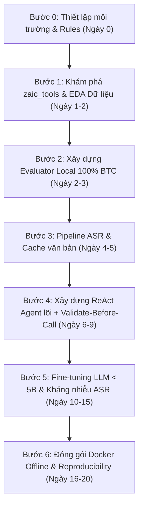

# Hướng Dẫn Quy Trình Tác Chiến - Zalo AI Challenge 2026 (Task 1: LifeMate)

> **Mục tiêu:** Tập trung 100% nguồn lực vào **Task 1: LifeMate (Voice-to-Action)** trong 20 ngày (27/10/2026 – 16/11/2026) để tối ưu hóa pipeline, fine-tune mô hình và đóng gói Docker chuẩn chỉ.

---

## Tóm Tắt "Luật Sinh Tử" Của Task 1

* **Giới hạn tham số:** 
  * Tổng toàn bộ hệ thống (ASR + LLM + khác) **< 6B tham số**.
  * Riêng LLM **< 5B tham số**, Context length $\le$ **16,384 tokens**.
* **Phần cứng & Thời gian:** 
  * Chạy offline (`--network none`) trên **1 × NVIDIA A30 (24GB VRAM)**, CPU 16 cores, 64GB RAM.
  * Tối đa **30 giây / mẫu** (quá thời gian hoặc crash = 0 điểm).
* **Cơ chế chấm điểm:**
  1. `state_hash` cuối cùng phải khớp tuyệt đối với đáp án chuẩn (sai `state_hash` $\rightarrow$ **0 điểm ngay lập tức**).
  2. Điểm của mẫu (khi đúng `state_hash`) tính theo **F1-score của chuỗi `tool_calls`**:
     $$P = \frac{M}{M + U}, \quad R = \frac{M}{|G|}, \quad F1 = \frac{2PR}{P + R}$$
  3. **Bẫy cực lớn ở `ToolEnv`:** Mỗi mẫu chỉ được khởi tạo `ToolEnv` **đúng 1 lần**. Mọi lệnh gọi `env.call()` dù bị từ chối do sai schema vẫn bị ghi vào lịch sử làm tăng $U$ (số lệnh không khớp) $\rightarrow$ **tụt điểm Precision $P$**! Do đó, bắt buộc phải gọi `env.validate()` trước khi gọi `env.call()`.

---

## Lộ Trình Tác Chiến 20 Ngày



---

## Chi Tiết Từng Bước Thực Hiện

### Bước 0: Thiết Lập "Hiến Pháp" Cho AI (30 phút đầu tiên)

#### [Việc Bạn Tự Tay Làm]
1. Khởi tạo repository và môi trường:
   ```bash
   git init
   uv init
   ```
2. Đặt dữ liệu vào thư mục `data/train+public_test/` (nhớ thêm `data/` vào `.gitignore`).
3. Tạo file `GEMINI.md` (hoặc `CLAUDE.md`) ở thư mục gốc để khóa chặt hành vi của AI:

```markdown
# PROJECT RULES - ZALO AI CHALLENGE 2026 (TASK 1: LIFEMATE)

## 1. Tech Stack & Môi trường
- Python 3.12+, quản lý gói bằng `uv`, kiểm tra code bằng `ruff` và `pytest`.
- Tổng tham số toàn bộ mô hình (ASR + LLM) BẮT BUỘC < 6 tỷ (6B). Riêng LLM < 5 tỷ (5B), context <= 16,384 tokens.
- Cố định toàn bộ random seeds (Python, NumPy, PyTorch) và luôn dùng `temperature = 0.0` (greedy decoding) để đảm bảo tính tái lập 100%.

## 2. Luật Cấm Tuyệt Đối (CRITICAL DON'Ts)
1. TUYỆT ĐỐI CẤM đọc trực tiếp file `state.json` từ ổ cứng dưới mọi hình thức (vi phạm sẽ bị loại khỏi cuộc thi). Mọi tương tác dữ liệu phải đi qua `zaic_tools.ToolEnv`.
2. CẤM khởi tạo lại `ToolEnv` nhiều hơn 1 lần cho mỗi `question_id`.
3. CẤM gọi trực tiếp `env.call(name, args)` khi chưa kiểm tra qua `env.validate(name, args)`. Nếu `env.validate()` báo lỗi (`ok == False`), phải trả lỗi về cho Agent sửa, không được đẩy vào `env.call()`.
4. CẤM gọi bất kỳ API internet nào trong luồng inference (container chạy ở chế độ offline `--network none`).
5. CẤM tự ý sửa file chấm điểm `src/eval/evaluator.py` sau khi đã chốt.
```

---

### Bước 1: Giải Phẫu `zaic_tools` & Khám Phá Dữ Liệu (Ngày 1 - 2)

#### [Việc Vibe Code - Giao Cho AI]

> **Prompt 1.1 (Mổ xẻ `zaic_tools`):**
>
> "Hãy đọc toàn bộ mã nguồn trong thư mục `train/zaic_tools/` và file `train/README.md`. Tóm tắt chi tiết vào file `docs/ZAIC_TOOLS_INTERNALS.md` các thông tin sau:
> 1. Các hàm public của class `ToolEnv` (`validate`, `call`, `get_tool_calls`, `get_state_hash`) hoạt động cụ thể ra sao?
> 2. Làm thế nào `zaic_tools` phân biệt giữa tham số `fuzzy` (chấm theo token-F1 > 0.6) và tham số `non-fuzzy` (khớp tuyệt đối)? Danh sách các tham số fuzzy nằm ở đâu?
> 3. Có những ràng buộc đặc biệt nào trong `train_tools_catalog.json` (như `required`, `x-one-of`, `x-ref`, `enum`, format ngày giờ)?"

> **Prompt 1.2 (Thống kê dữ liệu EDA):**
>
> "Dùng skill `data-quality-frameworks` và `python-pro` viết script `scripts/eda_task1.py` để phân tích `train/train.jsonl` và `train/train_tools_catalog.json`, sau đó in báo cáo ra màn hình:
> 1. Tổng số mẫu trong `train.jsonl` và `public_test.jsonl`, phân bố độ dài file `.wav`.
> 2. Tỷ lệ % các mẫu: (a) Gọi tool bình thường, (b) Gọi `sys.ask_missing_info`, (c) Out-of-scope (`tool_calls` là mảng rỗng `[]`), (d) Có lịch sử hội thoại `history` nhiều lượt.
> 3. Phân bố số lượng `tool_calls` trên mỗi mẫu (min, max, trung bình) và danh sách toàn bộ các ứng dụng (`installed_apps`) cùng số lượng tools trong catalog."

#### [Việc Bạn Tự Tay Làm]
1. Đọc kỹ báo cáo `docs/ZAIC_TOOLS_INTERNALS.md` mà AI vừa xuất ra.
2. Tự mở `train.jsonl` đọc **25-30 mẫu thực tế** (đủ cả 3 loại: gọi chuỗi tool có điều kiện, `sys.ask_missing_info`, và mảng rỗng `[]`).
3. Nghe thử **15-20 file `.wav`** (cả file lượt cuối `<id>.wav` lẫn các file trong lịch sử `<id>_u1.wav`) để cảm nhận giọng Bắc - Trung - Nam, tốc độ đọc số điện thoại, tên riêng ("Sếp Dũng", "Em Linh") và từ mượn tiếng Anh.

---

### Bước 2: Xây Dựng Bộ Chấm Điểm Local Chuẩn 100% BTC (Ngày 2 - 3)

#### [Việc Vibe Code - Giao Cho AI]

> **Prompt 2.1 (Viết Evaluator & Chia tập Validation):**
>
> "Dựa vào công thức tại Mục 3.1 trong `docs/ZALO_CHALLENGE_RAW.md` và mã nguồn `zaic_tools`, hãy dùng skill `agent-evals` và `llm-evaluation` thực hiện 3 việc:
> 1. Viết script `scripts/create_val_split.py` chia `train.jsonl` theo tỷ lệ 80% Train / 20% Validation (`val.jsonl` + một tập nhỏ `val_mini.jsonl` gồm 30 mẫu để test nhanh). Bắt buộc chia phân tầng (stratified) để giữ nguyên tỷ lệ các mẫu Out-of-scope (`[]`), mẫu có `sys.ask_missing_info`, và mẫu đa bước (multi-step).
> 2. Viết module `src/eval/evaluator.py` chấm điểm chính xác tuyệt đối theo công thức BTC:
>    - Replay lại `tool_calls` trên `ToolEnv` để kiểm tra `state_hash` khớp với gold `state_hash`.
>    - Nếu $|G| = 0$: đúng `[]` được 1 điểm, ngược lại 0 điểm.
>    - Nếu $|G| > 0$: kiểm tra `state_hash`, đối sánh cặp tối đa 1-1 giữa tool call nộp và gold (không phụ thuộc thứ tự) với điều kiện tên tool khớp, tham số `non-fuzzy` khớp tuyệt đối, tham số `fuzzy` đạt `token-F1 > 0.6` sau khi lowercase và chuẩn hóa Unicode NFC. Tính $P = \frac{M}{M+U}$, $R = \frac{M}{|G|}$ và $F1 = \frac{2PR}{P+R}$.
> 3. Viết unit test `tests/test_evaluator.py` kiểm chứng hàm chấm điểm."

#### [Việc Bạn Tự Tay Làm]
* Chạy `uv run pytest tests/test_evaluator.py`.
* Tự kiểm tra 3 kịch bản:
  1. Đưa nguyên `label.tool_calls` của `train.jsonl` vào hàm chấm $\rightarrow$ Điểm bắt buộc đạt **100.0**.
  2. Thử chèn thêm 1 lệnh gọi tool dư thừa (không làm đổi `state_hash`, ví dụ gọi thừa `contacts.search`) $\rightarrow$ Kiểm tra $U$ tăng lên 1 và điểm F1 giảm theo đúng công thức.
  3. Thử sửa nhẹ câu chữ trong trường `content` của `sms.send` (ví dụ: *"mai chạy bộ dời sang 9h nhé"*) $\rightarrow$ Kiểm tra hàm tính `token-F1 > 0.6` hoạt động đúng.

---

### Bước 3: Xử Lý Giọng Nói ASR & Cache Toàn Bộ Dữ Liệu (Ngày 4 - 5)

Ngân sách ASR: **< 1.5B tham số**. Ứng viên sáng giá:
* **`openai/whisper-large-v3-turbo`** (~809M tham số)
* **`vinai/PhoWhisper-medium`** (~769M tham số) hoặc **`vinai/PhoWhisper-large`** (~1.5B tham số)

#### [Việc Vibe Code - Giao Cho AI]

> **Prompt 3.1 (Dựng Pipeline ASR & Cache):**
>
> "Dùng skill `audio-transcriber` và `mlops-engineer` viết module `src/asr/transcriber.py` và script `scripts/cache_asr.py`:
> 1. Hỗ trợ chạy offline mô hình Whisper (cho phép cấu hình chọn `openai/whisper-large-v3-turbo` hoặc `vinai/PhoWhisper-large` bằng `faster-whisper` / `transformers` với `float16`).
> 2. Chạy phiên âm toàn bộ các file `.wav` trong `train` và `public_test` (lưu ý: phiên âm cả file audio chính `item['audio']` LẪN các file audio nằm trong `item['history']` nếu lượt history đó chưa có text).
> 3. Lưu kết quả ra `data/cache/asr_cache.parquet` và tính điểm WER / CER giữa văn bản ASR và cột `audio_text` chuẩn trên tập `train.jsonl`, xuất ra 50 câu bị nghe lệch nhiều nhất vào `logs/asr_errors.md`."

#### [Việc Bạn Tự Tay Làm]
* Đọc `logs/asr_errors.md` xem Whisper hay nghe sai chỗ nào trên tiếng Việt thực tế (đọc số tiền, giờ giấc `"7h30"` vs `"bảy giờ rưỡi"`, tên riêng, tên ứng dụng).
* Chốt model ASR nhanh nhất (< 1-2s/file trên GPU) và WER thấp nhất, ghi nhận số tham số chính xác (ví dụ `0.81B`) để trừ vào ngân sách `6B`.

---

### Bước 4: Xây Dựng Agent Lõi Với "Validate-Before-Call" (Ngày 6 - 9)

Ngân sách LLM: **< 5B tham số** (khuyên dùng **`Qwen2.5-3B-Instruct`** hoặc **`Qwen3-4B`**).
Sử dụng **Code Python thuần gánh tối đa việc tính toán thời gian và kiểm tra schema**.

#### [Việc Vibe Code - Giao Cho AI]

> **Prompt 4.1 (Chuẩn hóa Context & Bảng Lịch Tự Động):**
>
> "Dùng skill `context-engineering` viết module `src/agent/context_builder.py`:
> Khi nhận vào trường `context` và `history` của một mẫu:
> 1. Từ `current_time` (ví dụ `2026-11-28T07:10:00+07:00`), dùng Python tính sẵn một **Bảng quy chiếu thời gian (Calendar Cheat Sheet)** gồm: Thứ trong tuần của hôm nay, ngày hôm qua, ngày mai, ngày mốt, và toàn bộ các ngày từ Thứ Hai đến Chủ Nhật của tuần này và tuần sau theo đúng định dạng ISO `YYYY-MM-DD`. (Mục đích: giúp LLM 3B-4B tra cứu trực tiếp mà không phải tự cộng trừ ngày tháng).
> 2. Lọc từ `tools_catalog.json` và **CHỈ trích xuất JSON Schema của đúng các tools nằm trong `context['installed_apps']`** của mẫu đó, kèm theo schema của tool đặc biệt `sys.ask_missing_info`.
> 3. Định dạng rõ `user_profile` (tên, địa chỉ nhà, địa chỉ công ty, thành phố, tọa độ) và `history` thành prompt ngắn gọn, sạch sẽ, đảm bảo tổng độ dài luôn nằm sâu dưới ngưỡng 16K tokens."

> **Prompt 4.2 (Vòng lặp Thực thi ReAct + Chốt chặn `env.validate`):**
>
> "Dùng skill `agent-tool-builder`, `pydantic-ai` và `local-llm-expert` viết `src/agent/lifemate_runner.py` cài đặt vòng lặp thực thi đa bước (Multi-step ReAct Loop) với các quy tắc nghiêm ngặt sau:
> 1. Khởi tạo duy nhất 1 instance `env = ToolEnv(split=..., question_id=..., root=...)` ở đầu mỗi mẫu.
> 2. Ở mỗi bước (tối đa `MAX_STEPS = 8` để không bao giờ vượt 30s/mẫu), LLM nhận vào Context + Lịch sử các bước tool đã gọi trong phiên hiện tại, và quyết định:
>    - **Trường hợp A (Out-of-scope):** Nếu yêu cầu của người dùng cần ứng dụng không có trong `installed_apps`, kết thúc ngay lập tức mà không gọi tool nào (`tool_calls = []`).
>    - **Trường hợp B (Gọi Tool đọc/ghi dữ liệu):** Sinh ra tên tool và `arguments` dạng JSON hợp lệ.
>    - **Trường hợp C (Thiếu thông tin):** Nếu sau khi đã gọi các tool tra cứu (như `contacts.search`, `calendar.list_events`...) mà vẫn thiếu tham số bắt buộc không có trong câu nói hay `user_profile`, gọi `sys.ask_missing_info(tool_name=..., params=[...])` rồi dừng vòng lặp.
> 3. **Cơ chế Validate-Before-Call (Bắt buộc):**
>    - Trước khi gọi `env.call(name, args)`, code Python BẮT BUỘC gọi `val_res = env.validate(name, args)`.
>    - Nếu `val_res['ok'] == False`, KHÔNG gọi `env.call()`. Đưa thông báo lỗi `val_res['error']` vào hội thoại tạm thời để LLM tự sửa `arguments` (tối đa 2 lần retry cho 1 bước).
>    - Chỉ khi `val_res['ok'] == True`, mới thực thi `obs = env.call(name, args)` và đưa `obs` vào lịch sử bước kế tiếp.
> 4. Khi LLM báo hoàn tất, trích xuất `env.get_tool_calls()` và `env.get_state_hash()` để xuất ra đúng định dạng nộp bài."

#### [Việc Bạn Tự Tay Làm]
* Chạy thử `lifemate_runner.py` trên tập `val_mini.jsonl` (30 mẫu) ở 2 chế độ:
  * **Oracle Text:** Đưa `audio_text` chuẩn vào Agent để đo độ thông minh thuần túy của LLM + Prompt.
  * **End-to-End ASR:** Đưa text từ `asr_cache.parquet` vào Agent để đo độ suy giảm điểm do Whisper.
* Khi chạy xong trên `public_test.jsonl`, dùng skill `pre-release-review` kiểm tra `submission.jsonl` và **nộp thử lên cổng Zalo AI** (tối đa 5 lượt/ngày).

---

### Bước 5: Fine-Tuning LLM < 5B & Sửa Lỗi ASR (Ngày 10 - 15)

#### [Việc Bạn Tự Tay Làm (Phân Tích Lỗi)]
1. Dùng `agent-observability` và `error-diagnostics-error-analysis` xuất toàn bộ câu sai trên tập `val.jsonl`.
2. Đọc 20-30 mẫu sai và phân vào 4 rổ nguyên nhân:
   * **Rổ 1 – Lỗi ASR:** Whisper nghe sai tên riêng, bài hát, địa chỉ $\rightarrow$ `contacts.search` trả về rỗng.
   * **Rổ 2 – Nhầm Out-of-Scope / `ask_missing_info`:** Cố gọi tool khi không có app, hoặc chưa search danh bạ đã vội gọi `sys.ask_missing_info`.
   * **Rổ 3 – Lỗi Logic Đa bước (Multi-step):** Quên truyền `id` lấy từ bước trước (`evt_01`, `c_08`) sang bước sau.
   * **Rổ 4 – Lỗi Fuzzy Text (`token-F1 <= 0.6`):** Sinh câu chữ quá dài dòng hoặc sai lệch so với câu gốc của người dùng.

#### [Việc Vibe Code - Giao Cho AI]

> **Prompt 5.1 (Chuyển đổi `train.jsonl` thành dữ liệu SFT cho Qwen 3B/4B):**
>
> "Dựa vào cấu trúc `label['tool_calls']` và `label['tool_results']` trong `train.jsonl`, hãy viết script `scripts/build_sft_dataset.py`:
> Biến mỗi mẫu trong tập Train (80% split) thành một chuỗi hội thoại Multi-turn Tool-Use chuẩn định dạng ChatML của Qwen:
> - `system`: Chứa Context, Bảng lịch quy chiếu, và JSON Schema của `installed_apps`.
> - `user`: Yêu cầu của người dùng (kết hợp cả bản `audio_text` sạch VÀ bản text từ Whisper ASR để mô hình học cách tự kháng nhiễu chính tả ASR!).
> - Xen kẽ các lượt `assistant` (sinh `tool_call` bước $k$) và `tool` (trả về `tool_results` bước $k$ từ ground truth) cho đến bước cuối cùng.
> Xuất ra file `data/sft/lifemate_sft_train.jsonl` để tôi đem lên GPU fine-tune LoRA/Full-finetune."

> **Prompt 5.2 (Mẹo ăn trọn điểm `token-F1 > 0.6` cho trường Fuzzy):**
>
> "Hãy cập nhật System Prompt và bộ post-processing trong `src/agent/lifemate_runner.py`: Đối với mọi tham số dạng văn bản tự do (như nội dung tin nhắn `content` của `sms.send`, tiêu đề `title` của `calendar`, ghi chú `note`...), bắt buộc giữ lại tối đa các từ khóa gốc trong câu nói của người dùng (chỉ lược bỏ các từ đệm mệnh lệnh như *'nhắn cho'*, *'bảo là'*, *'nhắc tôi'*), tuyệt đối không tự ý bịa thêm câu chữ văn hoa làm giảm điểm `token-F1` so với câu gốc."

---

### Bước 6: Đóng Gói Docker Offline & Kiểm Tra Tái Lập (Ngày 16 - 20)

> [!WARNING]
> **Hạn chót nộp Docker image:** 23:59 ngày 16/11/2026 (chỉ được nộp tối đa 2 lần qua form).

#### [Việc Vibe Code - Giao Cho AI]

> **Prompt 6.1 (Viết Dockerfile & Script Chạy Offline trên 1x A30):**
>
> "Dùng skill `docker-expert` và `pre-release-review` viết `Dockerfile` và script `run_inference.sh` chuẩn theo quy định Mục 4.1 của Task 1:
> 1. Đóng gói sẵn toàn bộ model weights (ASR + LLM đã fine-tune/merge) vào bên trong Docker image. Thiết lập biến môi trường `HF_HUB_OFFLINE=1` và `TRANSFORMERS_OFFLINE=1`.
> 2. Container nhận dữ liệu test được mount tại `/data` và ghi kết quả ra `/result/submission.jsonl`.
> 3. Viết script kiểm tra tự động tổng số tham số của tất cả các model nạp lên VRAM, đảm bảo in ra xác nhận `< 6,000,000,000` tham số (và LLM `< 5,000,000,000`).
> 4. Bọc vòng lặp chạy từng sample trong khối `try...except` an toàn kèm bộ đếm timeout cứng **25 giây / mẫu** (nếu một mẫu chạy đến giây thứ 25 vẫn chưa xong, lập tức ngắt vòng lặp của mẫu đó và lấy `env.get_tool_calls()` + `env.get_state_hash()` hiện tại ghi ra file để không bị BTC phạt 0 điểm vì vượt mốc 30 giây)."

#### [Việc Bạn Tự Tay Làm - Checklist Sống Còn]
1. **Test ngắt mạng (`--network none`):**
   ```bash
   docker run --rm --gpus all --network none \
     -v $(pwd)/data/public_test:/data \
     -v $(pwd)/output:/result \
     my_lifemate_image
   ```
   Chạy trơn tru từ đầu đến cuối không có bất kỳ lỗi kết nối mạng nào mới đạt.
2. **Test tính tái lập (Reproducibility):** Chạy lệnh Docker trên **2 lần liên tiếp** ra 2 file `sub1.jsonl` và `sub2.jsonl`. So sánh 2 file — kết quả phải giống nhau từng byte (nhờ `temperature=0` và cố định seed).
3. **Kiểm tra VRAM & Tốc độ:** Trên NVIDIA A30 (24GB VRAM): ASR (~1.5GB) + LLM 3B-4B `bfloat16`/`float16` (~6-8GB) chiếm ~10-12GB VRAM. Tốc độ trên `vLLM` khoảng **2 - 5 giây / mẫu**, giúp chiếm ưu thế ở tiêu chí phụ **Tie-breaking** (thời gian chạy trung bình thấp hơn).

---

## 4 Lời Khuyên "Xương Máu" Cho Task 1

1. **Đừng bao giờ gọi `sys.ask_missing_info` khi chưa gọi tool tìm kiếm:** 
   * Xem mẫu `train_0001`: người dùng nói *"nhắn Sếp Dũng giờ mới"*. Agent ngây thơ thấy `sms.send` cần `contact_id` nên gọi ngay `sys.ask_missing_info` $\rightarrow$ **0 điểm**!
   * Agent chuẩn phải gọi `contacts.search(query="Sếp Dũng")` trước $\rightarrow$ lấy được `contact_id: "c_08"` $\rightarrow$ mới gọi `sms.send`. Chỉ gọi `sys.ask_missing_info` khi tìm kiếm trả về danh sách rỗng `[]` hoặc trả về kết quả mơ hồ.
2. **Dùng ASR Noise Augmentation khi Fine-tune:** 
   * Trong `train.jsonl`, cột `audio_text` là văn bản sạch. Nhưng khi test thật, LLM phải đọc văn bản do Whisper phiên âm. 
   * Hãy dùng chính văn bản Whisper phiên âm trên tập Train làm input `user` khi tạo SFT data. LLM sẽ học được cách kháng nhiễu và đoán đúng entity dù ASR nghe sai dấu/từ.
3. **Thứ tự gọi tool ảnh hưởng trực tiếp đến `state_hash`:** 
   * Dù thứ tự không ảnh hưởng khi tính ghép cặp $M$, nhưng đối với các thao tác thay đổi dữ liệu, thứ tự thực thi trên `ToolEnv` sẽ quyết định `state_hash`.
   * **Nguyên tắc vàng:** Gọi toàn bộ các tool **ĐỌC** (`get_*`, `list_*`, `search_*`) trước $\rightarrow$ Xử lý logic/điều kiện $\rightarrow$ Gọi các tool **GHI** (`create_*`, `update_*`, `send_*`, `set_*`) sau.
4. **Canh me Quota 5 lần nộp/ngày:** 
   * Hệ thống reset quota Public Test vào **00:00 GMT+7 mỗi đêm**.
   * Hãy tận dụng tối đa để kiểm tra phân bố của `public_test` so với `train` (tỷ lệ Out-of-scope, độ dài audio,...).
